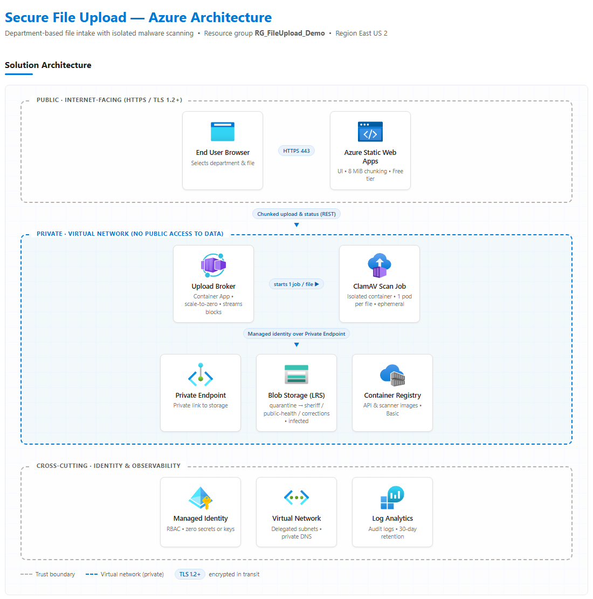

# Secure File Intake — Azure Static Web App with isolated ClamAV scanning

Users pick a department, upload a file of any practical size, and the file is
released to that department's blob container **only** after an isolated
container scans it with ClamAV and finds no threats.

Live: deploy your own by following **[DEPLOY.md](DEPLOY.md)**.



A full customer-facing version (data flow, security controls, cost) is in
[docs/architecture.html](docs/architecture.html) — open it in a browser.

---

## Architecture

```
Browser (SWA, Free tier)
   │  slices file into 8 MiB blocks, PUTs them in parallel
   ▼
Upload broker  (Container App, scale-to-zero, VNet)
   │  stages each block  ──────────────► Storage: quarantine container
   │  commits block list                 (private endpoint, managed identity)
   │
   └─ starts ONE isolated job execution per file
                     ▼
        ClamAV scan job  (Container Apps Job, fresh container per file)
                     │
       clean ────────┼──────► sheriff | public-health | corrections
       infected ─────┴──────► infected   (never reaches the department)
```

### Why this shape

The subscription enforces two policies that cannot be overridden at this scope:

- `allowSharedKeyAccess = false` — no account keys or key-based SAS
- `publicNetworkAccess = Disabled` — the blob endpoint is unreachable from the internet

The usual cheapest pattern (browser uploads direct to blob with a SAS) is
therefore impossible. Instead the browser still does the chunking, but streams
blocks to a broker that sits inside the VNet and reaches storage over a private
endpoint using a managed identity. No secrets or connection strings exist
anywhere in this solution.

### Isolation

Each upload gets its **own** container execution. The job is started per file
with `UPLOAD_ID` injected, runs `clamscan`, and is destroyed. Nothing is shared
between scans, and the scanner has no inbound network exposure.

---

## Large file handling

- The browser slices the file into **8 MiB blocks** (`frontend/app.js`) and uploads
  up to **4 in parallel**, each block retried independently with exponential backoff.
- Blocks are staged with Put Block and finalised with Put Block List, so the
  browser and the broker both hold only a few MiB in memory at any time —
  memory use is flat regardless of file size.
- 50,000 blocks × 8 MiB gives an **upload ceiling of ~400 GB**.
- **Scan ceiling is 2 GiB**: ClamAV cannot scan a file larger than `2 GiB - 1`.
  Files above that are *not* released; they stay in `quarantine` and the user is
  told it is held for manual review. Raise this by sharding large files or
  swapping in a scanner without that limit.

---

## Reference deployment resources (region East US 2)

Names below are examples; `DEPLOY.md` uses a unique suffix for yours.

| Resource | Example name | Purpose |
| --- | --- | --- |
| Static Web App (Free) | `swa-fileupload-<suffix>` | UI |
| Container App | `ca-upload-api` | Upload broker, scales to zero |
| Container Apps Job | `job-clamav-scan` | Isolated ClamAV scan, one per file |
| Container Apps Env | `cae-fileupload` | VNet-injected, consumption only |
| Storage (LRS) | `stfileup<suffix>` | Containers: `quarantine`, `sheriff`, `public-health`, `corrections`, `infected`, `status` |
| Container Registry (Basic) | `acrfileup<suffix>` | Scanner and broker images |
| VNet + Private Endpoint | `vnet-fileupload`, `pe-blob` | Private blob access |
| Managed Identity | `id-fileupload` | Blob Data Contributor, AcrPull, Jobs Operator |
| Log Analytics | `law-fileupload` | Job/app logs, 0.5 GB/day cap, 30-day retention |

### Cost control

- Static Web App **Free** tier.
- Container App and Job both **scale to zero** — no compute charge when idle.
- Storage is **LRS Hot**, no redundancy premium.
- Lifecycle policy (`lifecycle-policy.json`) deletes `quarantine` blobs after
  7 days and `infected`/`status` blobs after 30 days.
- Log Analytics capped at 0.5 GB/day.

The only meaningful fixed costs are the private endpoint (~$7.50/month, forced
by policy) and ACR Basic (~$5/month). Everything else is usage-based and
approximately zero when idle.

---

## Repository layout

```
frontend/     Static UI: department dropdown, chunked uploader, live scan status
api/          Upload broker (Node/Express) — init, block, complete, status
scanner/      ClamAV image (clamav/clamav:stable + Python worker)
test-upload.ps1       End-to-end CLI test (chunks, uploads, polls status)
lifecycle-policy.json Blob retention rules
```

### API

| Method | Route | Purpose |
| --- | --- | --- |
| POST | `/api/upload/init` | Validate department, create upload record, return `uploadId` |
| PUT | `/api/upload/block?id=&index=` | Stream one block into the quarantine blob |
| POST | `/api/upload/complete` | Commit the block list and start the scan job |
| GET | `/api/status?id=` | `uploading` → `queued` → `scanning` → `clean` / `infected` / `error` |
| GET | `/api/health` | Liveness |

---

## Verified behaviour

| Test | Result |
| --- | --- |
| Clean text file → Sheriff | Stored in `sheriff` |
| EICAR test virus → Corrections | Detected as `Eicar-Test-Signature`, moved to `infected`, **not** stored in `corrections` |
| 100 MB file (13 blocks) → Public Health | Chunked, committed, scanned, stored in `public-health` |
| CORS preflight from SWA origin | 204, origin echoed (locked to the SWA host) |

---

## Deploying and updating

See **[DEPLOY.md](DEPLOY.md)** for full step-by-step instructions, including how to push updates and run the end-to-end test.

---

## Notes before production use

- The app is **anonymous**. Add Entra ID auth on the Static Web App and validate
  the token in the broker before accepting uploads.
- ClamAV signatures are baked into the image at build time. Rebuild the scanner
  image on a schedule (or run `freshclam` at job start) to stay current.
- The scanner detects malware. It does not perform vulnerability analysis of
  file contents; add a dedicated tool if that is required.
- Storage is currently reachable only from the VNet. Reading files back out
  requires the same private path.
